# JAX & OpenXLA para Desarrolladores PyTorch

- **Por qué es relevante:** Pasar del dispatch imperativo operación por operación a la compilación de funciones completas con OpenXLA reduce el dispatch y fusiona operaciones dentro de un solo programa compilado, permite vectorizar gradientes per-sample sin loops en Python y ejecutar trayectorias secuenciales dentro de un solo `while` compilado. Todas las cifras de este repo se midieron en CPU.
- **Para quién es:** Ingenieros de Machine Learning y desarrolladores que dominan PyTorch (`nn.Module`, `loss.backward()`, `optimizer.step()`) y buscan dominar el modelo mental funcional de JAX (`@jax.jit`, PyTrees, `vmap`, `lax.scan`).
- **Quién debería verlo:** Equipos técnicos que entrenan o sirven modelos en GPUs y Cloud TPUs y necesitan eliminar cuellos de botella de lanzamiento de kernels y recompilaciones por formas dinámicas.
- **YouTube:** [Video de práctica — `jit`, `vmap` y `scan` escribiendo cada fragmento de `practica/`](https://youtu.be/49o55HV0fPU) · [Playlist De PyTorch a JAX y OpenXLA](https://www.youtube.com/playlist?list=PLeA4UbOTmMR0).
- **Substack:** [Del eager dispatch a la fusión XLA](https://ykro1.substack.com/p/del-eager-dispatch-a-la-fusion-xla) · [La memoria que el paso puro de JAX cobra y PyTorch no](https://ykro1.substack.com/p/memoria-del-paso-puro-de-jax) (amplía la práctica).
- **Índice de la serie:** Parte de la guía práctica [JAX & OpenXLA Field Guide](https://github.com/ykro/jax-openxla-field-guide).

---

## Arquitectura y Modelo Mental

### 1. Eager Dispatch vs Fusión de Operadores con `@jax.jit`

En modo eager, cada operación se despacha por separado desde Python y materializa sus buffers intermedios en la memoria del dispositivo (HBM en GPU/TPU, RAM en CPU). Al decorar con `@jax.jit`, JAX traza la función con `ShapedArray`, genera un `Jaxpr`, lo baja a `StableHLO` y el compilador OpenXLA produce un solo ejecutable que agrupa las etapas elementwise y de reducción en varias fusiones (en el experimento 01, en CPU, unas tres por vuelta del loop).



### 2. Ciclo de Vida de `@jax.jit`: Trazado vs Caché PJRT

La primera invocación con una firma `(shape, dtype)` nueva ejecuta el código Python para construir el grafo `Jaxpr` y compilar el binario XLA. Las llamadas posteriores con la misma forma geométrica omiten Python y envían directamente al binario cacheado en PJRT.



### 3. Vectorización con `vmap` y Loops Compilados con `lax.scan`

En lugar de iterar en Python sobre ejemplos de un batch o sobre pasos temporales, `jax.vmap` empuja el batch axis hacia las primitivas XLA y `jax.lax.scan` compila recurrencias largas en un solo `stablehlo.while` cuyo estado (`carry`) vive en buffers del dispositivo y no regresa a Python entre pasos.



---

## Resultados Reales de Verificación (`verify_speedup.py`)

Verificaciones de paridad deterministas; los tiempos son medianas de una corrida en CPU y varían entre corridas (±15–20 %). Python `3.12.11`, JAX `0.12.0.1` y PyTorch `2.15.0`. Cada speedup se mide contra su propio baseline: el 01 contra la misma función en JAX eager (PyTorch eager aparece como referencia, sin `torch.compile`), el 03 y el 04 contra loops de Python en JAX, y el 05 excluye del tiempo de buckets sus 3 compilaciones de warmup:

| Experimento | Archivo | Baseline | JAX + OpenXLA | Speedup / Paridad Numérica |
| :--- | :--- | :--- | :--- | :--- |
| **01. `@jax.jit` Operator Fusion** | `experiments/01_jit_operator_fusion.py` | `1.4469 ms` (JAX Eager) / `0.8348 ms` (PyTorch) | `0.147 ms` (`@jax.jit`) | **9.85x** (`max_diff = 3.34e-06`) |
| **02. Pure Functions & PyTrees** | `experiments/02_pure_functions_pytrees.py` | `loss = 0.845957` (`nn.Module` + SGD) | `loss = 0.845957` (`NamedTuple` PyTree) | **Paridad exacta** (`ΔW1 = 1.49e-08`) |
| **03. `vmap(grad)` Per-Sample Clip** | `experiments/03_vmap_batching.py` | `23.5479 ms` (loop Python, `B=128`) | `0.0854 ms` (`vmap(grad)`) | **275.75x** (`max_diff = 1.40e-09`) |
| **04. `lax.scan` 500-Step Rollout** | `experiments/04_lax_scan_unrolling.py` | `28.7024 ms` (loop Python, `T=500`) | `2.8633 ms` (`lax.scan`) | **10.02x** (`max_diff = 0.00e+00`) |
| **05. Static Bucket Padding** | `experiments/05_dynamic_shapes_trap.py` | `24 compilaciones` (`1173.93 ms`) | `3 compilaciones de warmup fuera del tiempo, 0 extra` (`20.19 ms`) | **58.15x** (`max_diff = 8.94e-08`) |

Salida íntegra de terminal generada por `verify_speedup.py`:

```text
==============================================================================
THE OUTSIDE JUDGE — jit, vmap, scan and buckets vs their baselines
==============================================================================
Runtime : Python 3.12.11 | JAX 0.12.0.1 | PyTorch 2.15.0 | Backend: cpu
CPU     : 10 cores | 1-min load average 5.5 before, 5.5 after
------------------------------------------------------------------------------
Experiment                         | Baseline       | JAX/XLA        | Speedup / Check
------------------------------------------------------------------------------
01. jit vs JAX eager               | 1.4469 ms      | 0.147 ms       | 9.85x (PASS)   
    jit vs PyTorch eager (reference) | 0.8348 ms      | 0.147 ms       | 5.68x (ref)    
02. Pure PyTree vs nn.Module       | loss=0.845957  | loss=0.845957  | Δ=1.5e-08 (PASS)
03. vmap(grad) vs Python loop      | 23.5479 ms     | 0.0854 ms      | 275.75x (PASS) 
04. lax.scan vs Python loop        | 28.7024 ms     | 2.8633 ms      | 10.02x (PASS)  
05. Buckets (3 warmups excluded)   | 24 compiles    | 0 extra comp   | 58.15x (PASS)  
------------------------------------------------------------------------------
Saved JSON report to: benchmarks/latest_results.json
ALL CHECKS PASSED (parity checks are deterministic; median timings vary run to run).
```

---

## Estructura del Repositorio

```text
.
├── benchmarks/
│   ├── latest_results.json         # Métricas verificadas por verify_speedup.py
│   └── terminal_output.txt         # Salida completa de los 5 experimentos y el juez
├── diagrams/
│   ├── 01-eager-vs-jit.{html,svg,png}
│   ├── 02-jit-lifecycle.{html,svg,png}
│   └── 03-vmap-scan-dataflow.{html,svg,png}
├── experiments/
│   ├── 01_jit_operator_fusion.py   # Jaxpr, StableHLO y fusión XLA vs Eager
│   ├── 02_pure_functions_pytrees.py# Estado inmutable PyTree vs PyTorch nn.Module
│   ├── 03_vmap_batching.py         # Gradientes por ejemplo con jax.vmap(jax.grad)
│   ├── 04_lax_scan_unrolling.py    # 500 pasos recurrentes con jax.lax.scan
│   └── 05_dynamic_shapes_trap.py   # Trampa de formas dinámicas y static bucketing
├── gcp/
│   └── run_gpu_tpu_benchmark.sh    # Runner on-demand con auto-teardown en Cloud TPU v5e y Vertex AI L4 GPU
├── practica/                       # Fragmentos del video de práctica (dos *_roto.py fallan a propósito)
├── tests/
│   ├── test_experiments.py         # Suite pytest determinista (5 tests)
│   └── test_practica.py            # Un test por fragmento de practica/ (11 tests)
├── Makefile
├── pyproject.toml
└── verify_speedup.py               # El Juez Externo (aserciones de paridad y speedup)
```

---

## Onboarding y Cómo Ejecutar Localmente o en Google Cloud

### 1. Instalación desde cero (macOS / Linux)

```bash
git clone https://github.com/ykro/jax-for-pytorch-devs.git
cd jax-for-pytorch-devs
python3 -m venv .venv
source .venv/bin/activate
pip install --upgrade pip
pip install -e ".[dev]"
```

### 2. Práctica a mano (los fragmentos del video de práctica)

La carpeta `practica/` tiene los fragmentos cortos que se escriben en el video de práctica. Los dos `*_roto.py` fallan a propósito: el error es parte del ejercicio. Escríbelos tú antes de abrirlos.

```bash
python practica/01_mutar_roto.py   # TypeError, los arreglos de JAX son inmutables
python practica/01_mutar.py        # .at[1].set(0.5) devuelve un arreglo nuevo
python practica/01_paso.py         # un paso de entrenamiento puro con value_and_grad y jax.tree.map
python practica/02_trazar.py       # el print corre al trazar, una vez por forma y tipo
python practica/02_if_roto.py      # TracerBoolConversionError, un if sobre un valor trazado
python practica/02_if.py           # jnp.where decide dentro del programa compilado
python practica/03_vmap_grad.py    # vmap(grad): un gradiente por ejemplo, recortado antes de promediar
python practica/04_scan.py         # el for se desenrolla en 2,500 ecuaciones; lax.scan queda en 1
python practica/04_formas.py       # 7 llamadas con 6 longitudes distintas, 6 compilaciones
python practica/04_buckets.py      # buckets de 64 y 128, 2 compilaciones; sin la máscara el relleno cambia la suma
```

### 3. Recorrido guiado paso a paso (Orden de Onboarding)

Ejecuta cada script en orden para observar la transición desde PyTorch Eager hasta OpenXLA compilado.

```bash
# Paso 1 — Fusión de operadores con @jax.jit e inspección de Jaxpr y StableHLO
python experiments/01_jit_operator_fusion.py

# Paso 2 — Funciones puras y PyTrees inmutables frente a torch.nn.Module
python experiments/02_pure_functions_pytrees.py

# Paso 3 — Vectorización de gradientes per-sample con jax.vmap(jax.grad)
python experiments/03_vmap_batching.py

# Paso 4 — Loops recurrentes compilados en un solo while con jax.lax.scan
python experiments/04_lax_scan_unrolling.py

# Paso 5 — Trampa de formas dinámicas y solución con static bucket padding
python experiments/05_dynamic_shapes_trap.py
```

### 4. Verificación completa (Linter + Tests + Juez Externo)

```bash
# Ejecutar únicamente el Juez Externo y generar benchmarks/latest_results.json
python verify_speedup.py

# Ejecutar ruff, pytest (16 tests) y verify_speedup.py en un solo comando
make all

# Lo mismo, y además el reporte de cada experimento, todo de una sola corrida
make report
```

### 5. Ejecución on-demand en Google Cloud (Cloud TPU v5e o NVIDIA L4 GPU)

El script `gcp/run_gpu_tpu_benchmark.sh` aprovisiona una Cloud TPU `v5litepod-1` (o un Custom Job en Vertex AI con GPU NVIDIA L4) en tu propio proyecto de Google Cloud (variable `GCP_PROJECT_ID`) y garantiza la destrucción automática de la instancia mediante `trap cleanup EXIT`. El script está listo, pero este repo todavía no publica cifras de TPU ni de GPU.

```bash
# Ejecutar benchmark en Cloud TPU v5e-1 on-demand (us-central1-a)
make gcp-tpu

# Ejecutar benchmark en Vertex AI Custom Job con GPU NVIDIA L4
make gcp-gpu
```
